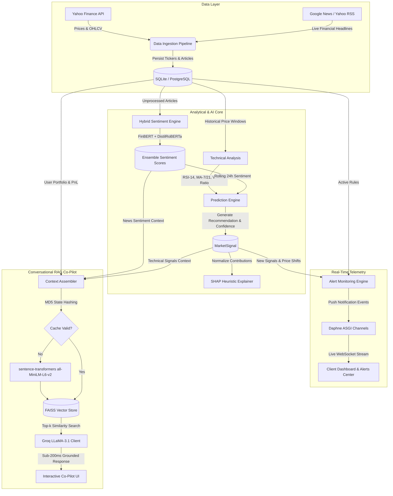

# 📈 FinSight AI (v1.0)
### *Next-Generation Financial Intelligence, Predictive Market Signals & Portfolio-Grounded RAG Co-Pilot*

[](https://www.python.org/)
[](https://www.djangoproject.com/)
[](https://github.com/django/daphne)
[](https://docs.celeryq.dev/)
[](https://huggingface.co/)
[](https://github.com/facebookresearch/faiss)
[](https://groq.com/)
[](LICENSE)

---

## 📌 Executive Summary

**FinSight AI 1.0** is an enterprise-grade financial intelligence platform designed to bridge the gap between **raw market feeds**, **unstructured news sentiment**, and **personalized portfolio context**. 

Standard retail trading tools force investors into fragmented workflows: checking one terminal for technical indicators, searching news aggregators for qualitative context, and asking generic AI chatbots that lack any knowledge of the user's actual portfolio holdings.

**FinSight AI 1.0 solves this by unifying:**
1. **Automated Real-Time Data Pipelines**: Continuous Yahoo Finance price synchronization and RSS financial headline scraping.
2. **Dual-Model NLP Sentiment Analysis**: Domain-adapted FinBERT + DistilRoBERTa ensemble scoring news sentiment between `-1.0` (bearish) and `+1.0` (bullish).
3. **Quantitative Signal Generation**: Fusing moving average crossovers (MA-7, MA-21), 14-day RSI, and volume momentum with NLP sentiment to generate clear `BUY`, `SELL`, `HOLD`, and `WATCH` signals.
4. **Transparent SHAP Feature Explanations**: Deconstructing every AI recommendation into explainable attribution scores (sentiment, momentum, volume, RSI).
5. **Real-Time WebSocket Alerts**: Live price thresholds and sentiment drop detection pushed instantly via Daphne ASGI WebSockets.
6. **Portfolio-Grounded Conversational RAG Co-Pilot**: An interactive assistant that embeds user holdings, live market data, and headlines into local FAISS vector stores to query LLaMA-3.1 via Groq with sub-second, hallucination-free answers.

---

## 🏛️ System Architecture



---

## ✨ Core Features (FinSight AI 1.0)

### 1. 🔄 Automated Data Collector & Ingestion
* **Multi-Source Fetching**: Scrapes real-time closing prices, daily high/lows, and volume using `yfinance`, alongside automated XML feed parsing for top financial news outlets.
* **Smart De-duplication**: Unique constraint enforcement (`stock_id`, `title`) prevents duplicate database bloat and ensures idempotent ingestion runs.
* **Optimized $O(\text{Tickers})$ Celery Scheduling**: Ingestion runs per distinct portfolio ticker rather than per user, eliminating redundant external API queries and rate limiting.

### 2. 🧠 Hybrid Dual-Model Sentiment Engine
* **Domain-Specific FinBERT**: Leverages ProsusAI's FinBERT to capture nuance in specialized financial lexicon (e.g., earnings beats, margin compression, hawkish central bank remarks).
* **Cross-Validation with RoBERTa**: Employs DistilRoBERTa as a general contextual sanity check.
* **Normalized Rolling Index**: Synthesizes output into a unified 24-hour sentiment score normalized between `-1.0` (extreme bearishness) and `+1.0` (extreme bullishness).

### 3. 📊 Predictive Market Signals & Quantitative Technicals
* **Technical Indicators**:
  * **Relative Strength Index (RSI-14)**: Identifies overbought ($>70$) and oversold ($<30$) extremes.
  * **Moving Average Convergence**: Tracks short-term trend momentum (7-day MA) against medium-term trend baseline (21-day MA).
  * **Volume Expansion Ratio**: Detects breakout confirmations when trading volume exceeds rolling averages.
* **Signal Classification**: Synthesizes qualitative NLP sentiment and quantitative momentum into discrete signals: `BUY`, `SELL`, `HOLD`, or `WATCH` with percentage confidence.

### 4. 🔍 Explainable AI (SHAP Heuristic Breakdown)
* Eliminates the traditional "black box" model problem.
* Every generated signal produces a breakdown of feature attributions:
  * **News Sentiment Impact**
  * **Price Trend Momentum**
  * **Volume Expansion**
  * **RSI Deviation**
* Rendered directly on the stock detail page so users understand *why* a signal was triggered.

### 5. ⚡ Real-Time WebSockets & Dynamic Alerts
* **Push over Polling**: Powered by **Django Channels** and the **Daphne ASGI** server.
* **Multi-Condition Alert Rules**:
  * Absolute or percentage price thresholds (e.g., alert when NVDA $> \$130$).
  * Sharp sentiment shifts (e.g., alert if 24-hour sentiment plummets below $-0.30$).
  * Unusual trading volume spikes.
* **Visual Flash Updates**: Live UI toasts and audio/visual flashes appear on the client interface without needing a browser reload.

### 6. 🤖 Portfolio-Grounded RAG Assistant (Co-Pilot)
* **Grounded in Your Holdings**: The assistant reads your user portfolio, current buy prices, share counts, unrealized gains/losses, recent news, and technical indicators.
* **Local Vector Storage**: Chunks data and embeds via `sentence-transformers/all-MiniLM-L6-v2` into an in-memory `faiss-cpu` index.
* **State Hashing Performance**: Calculates an MD5 hash of the current portfolio + market state. Re-indexes only when your holdings or latest market prices update, saving CPU cycles.
* **Ultra-Fast LLM Inference**: Formulates context-constrained prompts to **LLaMA-3.1** hosted on **Groq**, delivering contextual answers in under 300ms.

---

## 🛠️ Technology Stack

| Layer | Technology | Purpose |
| :--- | :--- | :--- |
| **Backend Framework** | **Django 5.0** | Robust ORM, authentication, model management, and routing |
| **ASGI & WebSockets** | **Daphne + Channels** | Asynchronous WebSocket connections and live event dispatching |
| **Task Queue & Broker** | **Celery + Redis** | Asynchronous data scraping, periodic checks, and background processing |
| **Database** | **SQLite / PostgreSQL** | Relational data persistence for stocks, prices, articles, and signals |
| **Sentiment Models** | **Hugging Face Transformers** | FinBERT & DistilRoBERTa CPU inference |
| **Vector Store & Embeddings** | **FAISS + Sentence-Transformers** | `all-MiniLM-L6-v2` semantic vector search |
| **LLM Inference** | **Groq Cloud SDK** | LLaMA-3.1 high-speed conversational generation |
| **Financial Data** | **yfinance + Feedparser** | Real-time ticker feeds, historical OHLCV data, RSS headlines |
| **Frontend UI** | **HTML5, Tailwind CSS, Chart.js** | Modern dark-themed dashboard, responsive charts, and UI telemetry |

---

## 📂 Project Structure (FinSight AI 1.0)

```plaintext
marketmind/
│
├── manage.py                     # Django CLI management script
├── celeryconfig.py               # Celery broker & schedule configuration
├── requirements.txt              # Core project dependencies
├── populate_db.py                # Database seeder for sample stocks & history
├── test_assistant.py             # Diagnostic test script for RAG Co-Pilot
│
├── marketmind/                   # Django Project Core
│   ├── settings.py               # Application settings, Channel layers, Celery setup
│   ├── asgi.py                   # ASGI application entrypoint (Daphne)
│   ├── wsgi.py                   # WSGI application entrypoint
│   └── urls.py                   # Top-level URL routing
│
├── accounts/                     # Authentication & User Management
│   ├── views.py                  # User login, registration, and logout views
│   ├── urls.py                   # Auth routing endpoints
│   └── templates/                # Custom auth UI templates
│
├── market/                       # Main Financial Intelligence Application
│   ├── models.py                 # Core schema (Stock, StockPrice, NewsArticle, SentimentScore, MarketSignal, Portfolio, AlertRule)
│   ├── views.py                  # Dashboard, stock detail, portfolio, alerts, assistant views
│   ├── urls.py                   # Market URL routing
│   ├── consumers.py              # WebSocket consumers for real-time telemetry & alerts
│   ├── routing.py                # Channels WebSocket protocol routing
│   ├── tasks.py                  # Celery scheduled tasks (periodic sync & alerts)
│   ├── utils/                    # Core Analytical Engines
│   │   ├── data_collector.py     # yfinance sync & RSS news scraper
│   │   ├── sentiment_engine.py   # FinBERT + RoBERTa ensemble pipeline
│   │   ├── prediction_engine.py  # RSI-14, Moving Averages, and signal generator
│   │   ├── explainer.py          # SHAP attribution score calculator
│   │   ├── alert_engine.py       # Multi-variable rule evaluation engine
│   │   └── rag_assistant.py      # FAISS indexing, embeddings, and Groq LLaMA-3.1 co-pilot
│   └── templates/                # Frontend templates
│       ├── base.html             # Main layout, navbar, live WebSocket script
│       ├── dashboard.html        # Market overview, top gainers, live signals
│       ├── stock_detail.html     # Interactive charts, news feed, SHAP breakdown
│       ├── portfolio.html        # User holdings, P&L calculations, buy/sell modal
│       ├── alerts.html           # Alert rules configuration and history
│       └── assistant.html        # Conversational RAG co-pilot interface
│
└── static/                       # Static Assets
    ├── css/                      # Custom CSS stylesheets
    └── js/
        └── websocket.js          # Client-side WebSocket connection and toast alerts
```

---

## 🚀 Getting Started

### 1. Prerequisites
* **Python**: 3.11 or higher
* **Redis**: Required for Celery background tasks and Channel layers (`redis-server`)
* **Groq API Key**: Free API key from [Groq Console](https://console.groq.com)

### 2. Clone the Repository
```bash
git clone https://github.com/chethan2903/FinSight-AI.git
cd FinSight-AI
```

### 3. Create and Activate Virtual Environment
```bash
# macOS/Linux
python3 -m venv venv
source venv/bin/activate

# Windows (PowerShell)
python -m venv venv
.\venv\Scripts\Activate.ps1
```

### 4. Install Dependencies
```bash
pip install --upgrade pip
pip install -r requirements.txt
```

> **Note for PyTorch (CPU-Optimized)**:
> If installing on a machine without a dedicated GPU, ensure CPU-optimized torch is installed:
> ```bash
> pip install torch --extra-index-url https://download.pytorch.org/whl/cpu
> ```

### 5. Configure Environment Variables
Create a `.env` file in the project root:
```ini
SECRET_KEY=django-insecure-marketmind-super-secret-key-12345
DEBUG=True
DATABASE_URL=sqlite:///db.sqlite3
REDIS_URL=redis://localhost:6379/0
GROQ_API_KEY=your_groq_api_key_here
```

### 6. Run Migrations & Seed Initial Data
```bash
python manage.py makemigrations
python manage.py migrate

# Populate popular stocks (AAPL, MSFT, GOOGL, NVDA, TSLA, etc.) with sample history:
python populate_db.py
```

### 7. Start Background Workers

#### Terminal 1: Redis Server
```bash
redis-server
```

#### Terminal 2: Celery Worker
```bash
celery -A marketmind worker -l info
```

#### Terminal 3: Celery Beat (Periodic Sync)
```bash
celery -A marketmind beat -l info
```

### 8. Run the Development Server (Daphne ASGI)
To ensure WebSockets and real-time streaming work correctly, run the application using **Daphne**:
```bash
daphne -b 127.0.0.1 -p 8000 marketmind.asgi:application
```
*(Or alternatively, `python manage.py runserver` for standard HTTP development).*

Open your browser and navigate to:
```
http://127.0.0.1:8000
```

---

## ⚡ Performance & Engineering Optimizations

1. **Lazy-Loaded Model Singletons**:
   Heavy machine learning models (`ProsusAI/finbert`, `sentence-transformers`) are wrapped in lazy singleton wrappers. They load on-demand rather than during Django/Daphne startup, cutting server boot time from 30+ seconds to instant.
2. **MD5 State Hashing for Vector Retrieval**:
   Rather than rebuilding the FAISS index on every chat message, the assistant hashes the user's holdings and latest prices. If the hash matches the cache, vector re-computation is skipped, maintaining query latency under 300ms.
3. **Optimized Scraping Cadence**:
   The data collector tracks the last synchronization timestamp for each ticker, bypassing redundant requests if updated within the last 5 minutes.
4. **Non-Blocking ASGI Event Broadcast**:
   Alert notifications are processed asynchronously and broadcast via Redis Channel layers, preventing user-facing HTTP requests from being blocked by alert computations.

---

## 🧪 Verification & Testing

Verify that your analytical pipeline and RAG co-pilot are operational:

```bash
# Run unit and integration tests
python manage.py test market

# Run diagnostic verification on RAG assistant and Groq LLM integration
python test_assistant.py
```

---

## 🛡️ License

This project is licensed under the **MIT License** — see the [LICENSE](LICENSE) file for details.

---

## 👤 Author & Acknowledgments

* **Developer**: [G Chethan Gowda](https://github.com/chethan2903)
* **Project**: [FinSight-AI (MarketMind)](https://github.com/chethan2903/FinSight-AI)
* **Built With**: Python, Django, Daphne, Hugging Face, FAISS, and Groq.
